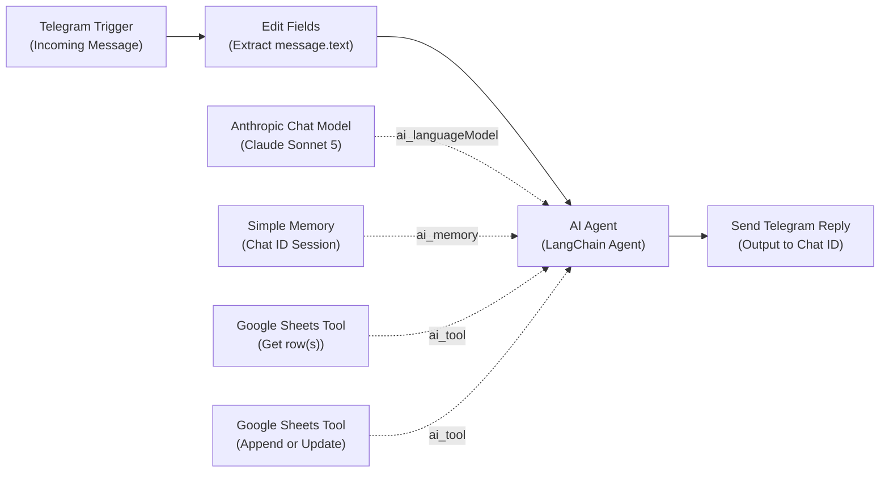

<p align="center">
  
</p>

# Kirana AI Bot (n8n Workflow)

An AI-powered Telegram inventory assistant (**[@Kirana_AI_bot](https://t.me/Kirana_AI_bot)**) for Kirana (neighborhood grocery) stores, built with **n8n**, **Claude Sonnet 5 (Anthropic)**, and **Google Sheets**.

Store owners and staff can message [@Kirana_AI_bot](https://t.me/Kirana_AI_bot) on Telegram in natural language to check stock levels, record receipts/sales/adjustments, view low-stock or stockout alerts, and generate category or valuation reports backed by a live Google Sheet.

---

## Architecture



### Workflow Nodes

| Node | Type | Purpose |
| :--- | :--- | :--- |
| **Telegram Trigger** | `n8n-nodes-base.telegramTrigger` (v1.5) | Listens for incoming Telegram `message` updates. |
| **Edit Fields** | `n8n-nodes-base.set` (v3.5) | Extracts `message.text` for the AI Agent. |
| **AI Agent** | `@n8n/n8n-nodes-langchain.agent` (v3.1) | Interprets user intent, enforces inventory rules, and calls tools. |
| **Anthropic Chat Model** | `@n8n/n8n-nodes-langchain.lmChatAnthropic` (v1.6) | Uses `claude-sonnet-5` (Claude Sonnet 5). |
| **Simple Memory** | `@n8n/n8n-nodes-langchain.memoryBufferWindow` (v1.4) | Per-chat conversation memory keyed by `message.chat.id`. |
| **Get row(s) in sheet in Google Sheets** | `n8n-nodes-base.googleSheetsTool` (v4.7) | Reads live rows from the `Inventory` worksheet. |
| **Append or update row in sheet in Google Sheets** | `n8n-nodes-base.googleSheetsTool` (v4.7) | Updates or appends rows in the `Inventory` worksheet. |
| **Send Telegram Reply** | `n8n-nodes-base.telegram` (v1.2) | Sends the agent's `$json.output` back to the user's Telegram chat. |

---

## Repository Structure

```text
Inventory-Management/
├── assets/
│   └── banner.png                       # Repository hero banner
├── docs/
│   └── system-prompt.xml                # Extracted AI Agent system prompt
├── templates/
│   └── kirana-inventory-template.csv    # Starter Google Sheet CSV template
├── workflows/
│   └── kirana-ai-bot.json               # Sanitized, import-ready n8n workflow
├── .gitignore
├── LICENSE
└── README.md
```

---

## Prerequisites

- **n8n** (Cloud or self-hosted, supporting LangChain AI Agent nodes)
- **Telegram Bot Token** (created via [@BotFather](https://t.me/BotFather))
- **Anthropic API** access (or n8n AI Gateway) for Claude Sonnet 5
- **Google Sheets** account with OAuth2 credentials configured in n8n

---

## Setup Guide

### 1. Create the Google Sheet

1. Create a new Google Sheet named **Kirana Inventory**.
2. Rename the first tab to **`Inventory`**.
3. Import [`templates/kirana-inventory-template.csv`](templates/kirana-inventory-template.csv) or create the following header columns:

| Column | Type | Description |
| :--- | :--- | :--- |
| `SKU` | String | Unique item identifier (e.g., `KIR-001`) |
| `Product` | String | Product name (e.g., `Basmati Rice 5kg`) |
| `Category` | String | Product category (e.g., `Grains & Staples`) |
| `Unit` | String | Unit of measure (e.g., `bag`, `pack`, `bottle`) |
| `Price` | Number | Unit price used for valuation estimates |
| `Stock` | Number | Current available stock quantity |
| `ReorderLevel` | Number | Minimum threshold before a `LOW_STOCK` alert is triggered |

### 2. Import the n8n Workflow

1. Open your n8n instance and click **Add workflow** → **Import from File**.
2. Select [`workflows/kirana-ai-bot.json`](workflows/kirana-ai-bot.json).
3. Configure credentials on the nodes:
   - **Telegram Trigger** & **Send Telegram Reply**: Select your Telegram Bot API credential.
   - **Anthropic Chat Model**: Connect your Anthropic API credential (or AI Gateway).
   - **Get row(s) in sheet in Google Sheets** & **Append or update row in sheet in Google Sheets**: Select your Google Sheets OAuth2 credential and pick your **Kirana Inventory** document and **`Inventory`** sheet.
4. Save and toggle the workflow **Active**.

---

## Example Telegram Prompts

- **Check Inventory:** `"Show me the full inventory status"` or `"Which items are low on stock or out of stock?"`
- **Record a Sale:** `"Sold 3 bags of Basmati Rice 5kg (KIR-001)"`
- **Record a Restock:** `"Received 20 packs of Amul Butter 500g (KIR-005)"`
- **Valuation Estimate:** `"What is our total inventory valuation?"`
- **Category Breakdown:** `"Show stock for Dairy"`

---

## Notes

- **Sanitized Export:** All personal credential IDs, Google Sheet IDs, webhook IDs, and n8n instance IDs have been replaced with safe placeholders in `workflows/kirana-ai-bot.json`.
- **Complete System Prompt:** The `AI Agent` `systemMessage` in `workflows/kirana-ai-bot.json` and [`docs/system-prompt.xml`](docs/system-prompt.xml) includes the full `<inventory_agent_instructions>` XML structure.
- **Exact SKU Matching:** The `Append or update row in sheet in Google Sheets` node is configured to match rows on `SKU` (`matchingColumns: ["SKU"]`), ensuring updates target exact SKUs without ambiguity.

---

## License

This project is licensed under the [MIT License](LICENSE).
